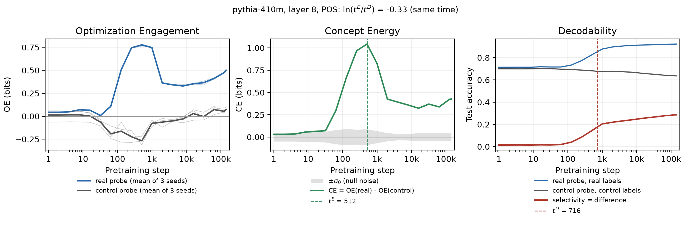

# Geometrically Disentangling Concept Learning from the Language Modeling Loss

Code for the NeurIPS 2026 paper by Yupei Wang, Neil Mallinar, Mikhail Belkin and Alex Warstadt (UC San Diego).

A linear probe tells us that a concept can be read out of a layer. This code asks a different question: does the
language-modelling loss itself care about the probe's directions? At each pretraining checkpoint we compare the probe's
weight subspace with the average gradient outer product (AGOP) of the next-token loss at the same layer, and track how
the two line up over training.

## One command

```bash
git clone https://github.com/YpLarryWang/concept-energy.git && cd concept-energy
python -m venv .venv && source .venv/bin/activate && pip install -r requirements.txt
bash reproduce.sh
```

`bash reproduce.sh` checks the environment (GPU, package versions), downloads the data on the first call, and
reproduces the POS result at layer 8 of Pythia-410M over the paper's 19 checkpoints (step 1 to 143k, about 35 minutes
on an A100). For every checkpoint it

1. computes the **AGOP** `G` of the next-token loss with respect to the layer's residual stream (1,000 WikiText-103 lines,
   8 sampled positions each);
2. extracts the layer's word representations on UD English EWT and trains **3 real probes** (16 UPOS classes) and
   **3 type-matched control probes** (each word type gets a fixed random label with the real class shares);
3. measures each probe's **Optimization Engagement**: with `U` the top `k` right singular vectors of the probe's
   class-centred weights (`k` = classes − 1), `OE = log2( (tr(UᵀGU) / tr G) / (k / d) )` (0 = a random subspace);
4. reports **Concept Energy** `CE = OE(real) − OE(control)`, **decodability** as selectivity (real score − control
   score), the null noise scale **σ₀** of OE, and the event times **t^D** (fastest rise of decodability), **t^E**
   (first clear peak of CE) and their lag `ln(t^E / t^D)`;
5. draws the three curves, compares every number with the paper's values (`reference/`) and ends with **PASS** or
   **FAIL**.



## Every task, layer and model

The same command runs any of the paper's 12 tasks:

```bash
bash reproduce.sh TASK [LAYER] [MODEL]     # e.g. bash reproduce.sh trigram_pmi 12 pythia-1b
bash reproduce.sh check                    # quick test: every task at layer 8, steps 512 and 143000 (~20 min)
bash reproduce.sh all [MODEL]              # all tasks x all layers x 19 checkpoints, plus the event-time figure
```

| Task | In the paper | Data | Probe reads | Labels or targets | Score |
|---|---|---|---|---|---|
| `pos` | POS | UD English EWT | each non-punctuation word | 16 UPOS tags | test accuracy |
| `dep_relation` | Dependency relation | UD English EWT | each non-punctuation word | 30 relations to the head (subtype stripped) | test accuracy |
| `dep_length` | Dependency length | UD English EWT | each non-punctuation word | ROOT, or head left/right at distance 1, 2, 3–5, 6+ | test accuracy |
| `dep_depth` | Dependency depth | UD English EWT | each non-punctuation word | arcs up to the root: 0–10, 11+ | test accuracy |
| `ner` | NER | UNER English EWT | entity tokens | PER, ORG, LOC | test accuracy |
| `noun_supersense` | Noun supersense | STREUSLE 5.0 | single-word noun expressions | 12 supersenses | test accuracy |
| `verb_supersense` | Verb supersense | STREUSLE 5.0 | single-word verb expressions | 9 supersenses | test accuracy |
| `unigram_lp` | Unigram LP | WikiText-103 | token `w_t` | log p(w_t) | held-out R² |
| `bigram_lp` | Bigram LP | WikiText-103 | token `w_t` | log p(w_t \| w_t−1) | held-out R² |
| `bigram_pmi` | Bigram PMI | WikiText-103 | token `w_t` | log p(w_t \| w_t−1) − log p(w_t) | held-out R² |
| `trigram_lp` | Trigram LP | WikiText-103 | token `w_t` | log p(w_t \| w_t−2 w_t−1) | held-out R² |
| `trigram_pmi` | Trigram PMI | WikiText-103 | token `w_t` | log p(w_t \| w_t−2 w_t−1) − log p(w_t \| w_t−1) | held-out R² |

Classification tasks keep the classes with at least 100 training and 10 test words; words are always read in their whole
sentence. The n-gram targets are counted on WikiText-103 with the Pythia tokenizer; the train/eval split is by n-gram,
so the eval pool holds only n-grams unseen in training, and the probe is a linear regression (`k` = 1, `U` = its
normalised weight vector). The control of an n-gram task gives every n-gram the target of a random sample of the same
pool. Details are in the docstrings of `probe_agop/tasks.py` and `probe_agop/ngram.py`.

`reproduce.sh` calls `run.py`, which takes any combination directly:

```bash
python run.py --task pos,ner,unigram_lp --layers 0,8,23 --model pythia-410m
```

| Argument | Default | Meaning |
|---|---|---|
| `--task` | (required) | comma-separated task names, or `all` |
| `--layers` | (required) | comma-separated transformer blocks (0–23 for Pythia-410M, 0–15 for Pythia-1B), or `all` |
| `--model` | `pythia-410m` | `pythia-410m` or `pythia-1b` |
| `--checkpoints` | the paper's 19 steps | comma-separated training steps |
| `--out` | `runs` | output root; results go to `OUT/<model>/` and a repeated command resumes |
| `--data-dir` | `data` | where `scripts/download_data.sh` put the data |
| `--agop-batch-size`, `--layer-chunk` | 8, 6 | memory only: sequences per AGOP batch, layers extracted per pass over the data |

**Time and memory.** On an A100 (40 GB), one checkpoint of the AGOP for all layers takes under a minute, and one probe
takes about 6 s on the large UD tasks (177k words) and less on the others. One task at one layer takes 10–40 minutes.
`all` takes roughly a day per model; several `run.py` processes with different `--task` or `--layers` can share one
GPU and one `--out`. At most about 5 GB of GPU memory is used for Pythia-410M. The first n-gram run counts n-grams on
WikiText-103 once (about 5 minutes and 10 GB of RAM) and caches the targets in `data/ngram/`.

## Output

```
runs/pythia-410m/
  agop/step*/layer*.npy           the AGOP matrices (float64, d x d), shared by all tasks
  pos/config.json                 the full configuration; a rerun with another configuration into the same folder stops
  pos/layer8/step*.json           per checkpoint: OE and score of each probe, σ₀, participation ratio of G
  pos/layer8/summary.json         all curves (per seed and averaged), events, σ₀ statistics, comparison with the paper
  pos/layer8/curves.png, .pdf     OE (real, control), CE with ±σ₀, decodability; t^E and t^D marked
  pos/task_events.json            with all layers: the task-level event times (the paper's event-time figure)
  event_times.png, .pdf           with all layers of one or more tasks: task-level t^D against t^E
```

The run also prints a table of all checkpoints and, per (task, layer), the largest difference from the paper.
A result passes when OE and CE differ from the paper by at most 0.02 bits, accuracies and R² by at most 0.002, and,
on the full checkpoint grid, the event times are identical.

## Agreement with the paper

We reran the release on an A100 (Python 3.12, torch 2.7.1, transformers 4.57.3) and compared with the paper's values:

- **POS, Pythia-410M, layers 0, 6, 8, 12, 18 and 23, all 19 checkpoints:** every test accuracy is identical; CE differs
  by at most 0.005 bits (σ₀ is about 0.05 bits); t^D and t^E are identical at every layer.
- **The other six classification tasks, Pythia-410M, layer 8, steps 512 and 143000:** identical accuracies; OE and CE
  within 0.005 bits.
- **The five n-gram tasks, same cells:** identical held-out R²; OE and CE within 0.011 bits (σ₀ is about 0.25 bits for
  `k` = 1).
- The data of all 12 tasks (words, labels, control labels, n-gram targets and splits) is identical to the paper's, and
  `tests/` recomputes every per-layer event and task-level event time of the paper from `reference/`.

OE differs slightly because the AGOP is recomputed in float32. The paper's AGOP files mix float32 and float16 runs
(Pythia-1B, the last layer of Pythia-410M, and step 128000 of Pythia-410M were float16); float16 results depend on the
GPU, so float32 is the better reference. For Pythia-1B, the float32 AGOP differs from the paper's by about 0.2% at middle
and late layers and up to 4% at layer 0 of late checkpoints; we did not rerun the Pythia-1B probes for this release.

## How the code is organised

| File | Content |
|---|---|
| `reproduce.sh` | environment check, data download and the runs above |
| `run.py` | the experiment: AGOP, probes, OE, CE, decodability, σ₀, events, figures, comparison with the paper |
| `probe_agop/data.py` | reading UD English EWT, UNER English EWT, STREUSLE and WikiText-103 (with checks of every file) |
| `probe_agop/tasks.py` | the 12 tasks: labels, classes, rows, control labels, probe fitting |
| `probe_agop/ngram.py` | n-gram counts, targets, the train/eval split and the pool control |
| `probe_agop/controls.py` | type-matched control labels of the classification tasks |
| `probe_agop/model.py` | loading checkpoints; reading block outputs with forward hooks; word and token representations |
| `probe_agop/agop.py` | the AGOP of the next-token loss at sampled positions, for several layers at once |
| `probe_agop/probe.py` | input centring and the probe training recipe (Adam, 10 epochs) |
| `probe_agop/energy.py` | OE, the participation ratio of G, and σ₀ |
| `probe_agop/events.py` | t^D, t^E, the lag, and the layer-weighted task-level event times |
| `probe_agop/plot.py` | the figures |
| `reference/<model>/<task>.json` | the paper's OE and scores per layer, checkpoint and seed, and its event times |
| `tests/test_metrics.py` | CPU checks of the metrics, including the paper's event times of every task and model |

## Data and licenses

| Data | Used for | Version | License |
|---|---|---|---|
| [Pythia](https://github.com/EleutherAI/pythia) checkpoints | all experiments | `step1` … `step143000` on Hugging Face | Apache-2.0 |
| [WikiText-103](https://huggingface.co/datasets/Salesforce/wikitext) | AGOP corpus; n-gram tasks | `wikitext-103-v1` | CC BY-SA 3.0, GFDL |
| [UD English EWT](https://github.com/UniversalDependencies/UD_English-EWT) | POS and dependency tasks | v2.17 | CC BY-SA 4.0 |
| [UNER English EWT](https://github.com/UniversalNER/UNER_English-EWT) | NER | commit `8ed072de` | CC BY-SA 4.0 |
| [STREUSLE](https://github.com/nert-nlp/streusle) | noun and verb supersenses | 5.0 (commit `8ba61fe4`) | CC BY-SA 4.0 |

`scripts/download_data.sh` fetches the exact files used in the paper and checks their SHA-256; `transformers` downloads
the Pythia checkpoints on first use. The paper's behavioural analyses (subject–verb agreement with BLiMP, output KL) and
robustness checks are not part of this repository.

## Citation

```bibtex
@inproceedings{wang2026geometrically,
  title     = {Geometrically Disentangling Concept Learning from the Language Modeling Loss},
  author    = {Wang, Yupei and Mallinar, Neil and Belkin, Mikhail and Warstadt, Alex},
  booktitle = {Advances in Neural Information Processing Systems},
  year      = {2026}
}
```

## License

Code: Apache-2.0 (see `LICENSE`).
